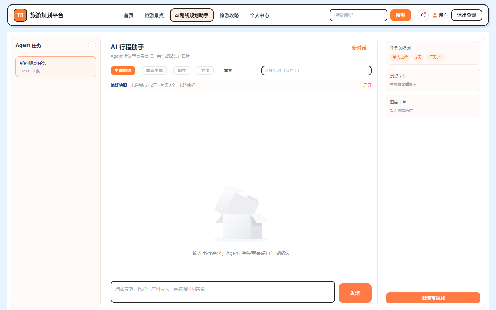
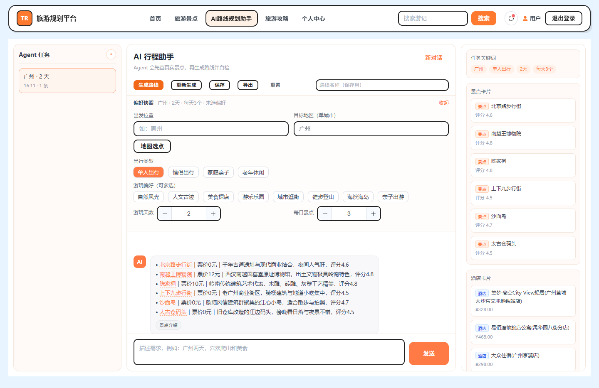

# 智能旅行规划平台（AI Travel Planner）

一个面向毕业设计的全栈旅行系统：**路线规划 + AI Agent + RAG 知识库 + 酒店交易 + 游记社区**。

前端 Vue3 + Element Plus，后端 FastAPI + MySQL 8，AI 层基于 DeepSeek Function Calling 与本地向量检索（fastembed + BGE-zh）。

---

## 功能概览

### 用户端
- **景点**：省份/关键词搜索、分页、详情、实景图轮播、评分/票价/标签、点评、收藏
- **游记社区**：广场、详情、图片轮播、点赞/收藏/评论、公开/私密/仅好友
- **社交**：关注、私信（未回复前不能连发）、拉黑、用户主页
- **路线规划**：偏好加权贪心 + 集群距离过滤 + 资源不足降级；地图展示 + 路线顺序 + 酒店推荐
- **酒店**：列表/详情、房型、在线预订 → 订单 → 支付（模拟）→ 入住登记 → 账单
- **AI 行程助手**：自然语言生成行程、景点介绍、多轮追问、流式输出

### 商家端
- 酒店资料维护 + 资质认证（独立审核流）
- 订单处理、办理入住、房态维护、客人登记

### 管理端
- 景点 / 酒店 / 用户 / 内容 / 商家审核管理、数据概览

### 界面预览

| AI 行程助手（规划页） | 生成路线与地图 |
|---|---|
|  |  |

首页：


---

## 技术栈

| 层 | 技术 |
|---|---|
| 前端 | Vue3 `<script setup>`、Vite、Element Plus、ECharts、Leaflet |
| 后端 | FastAPI、SQLAlchemy、Pydantic、JWT |
| 数据库 | MySQL 8（20 张表，InnoDB / utf8mb4） |
| AI | DeepSeek `chat/completions` + Function Calling；fastembed + `BAAI/bge-small-zh-v1.5`（ONNX，无需 torch） |
| 地图 | Leaflet + 栅格瓦片（默认高德瓦片，无需 Key，可换天地图/OSM） |

---

## 目录结构

```
毕业设计AI/
├─ backend/
│  ├─ api/v1/            # 接口：auth/spot/post/hotel/trip/ai/merchant/admin...
│  ├─ services/          # 业务：trip_service、agent_runner、agent_tools、rag、spot_intro
│  ├─ models/            # 20 张表的 ORM 模型
│  ├─ schemas/           # Pydantic 入参/出参
│  ├─ scripts/           # 数据导入、种子数据、RAG 建库、安全删除等
│  └─ data/              # 运行时数据（RAG 索引、Agent 会话，已 gitignore）
├─ frontend/
│  ├─ src/views/         # 34 个页面（plan / spot / hotel / post / user / merchant / admin）
│  ├─ src/components/    # 通用组件（RouteLeafletMap、HotelPicker、ChatDialog...）
│  └─ src/api|utils      # 接口封装与工具
└─ README/
```

---

## Docker 一键启动（推荐体验）

前置：安装 Docker Desktop（Windows/macOS）或 Docker Engine + Compose。

```bash
# 1. 配置环境变量（可留空，AI 会自动降级）
cp .env.docker.example .env      # Windows: copy .env.docker.example .env

# 2. 构建并启动（MySQL + 后端 + 前端）
docker compose up -d --build
```

| 服务 | 地址 |
|---|---|
| 前端 | http://localhost:8080 |
| 后端 API 文档 | http://localhost:8000/docs |
| MySQL（宿主机端口） | 127.0.0.1:3307（容器内 3306） |

说明：
- 启动时自动执行 `scripts/create_tables.py` 建表，**数据库初始为空**；
- 导入演示数据（需在容器内执行，部分脚本依赖高德 Key / Excel）：
  ```bash
  docker compose exec backend python scripts/import_guangzhou_spots.py
  docker compose exec backend python scripts/add_guangzhou_hotels.py
  docker compose exec backend python scripts/seed_review_users.py
  ```
- 构建 RAG 索引：
  ```bash
  docker compose exec backend python scripts/build_rag_index.py
  ```
- 停止 / 清理：
  ```bash
  docker compose down          # 保留数据库数据
  docker compose down -v       # 同时删除数据卷
  ```

## 快速开始

### 1. 数据库

```sql
CREATE DATABASE travel_bishe DEFAULT CHARACTER SET utf8mb4 COLLATE utf8mb4_general_ci;
```

### 2. 后端

```powershell
cd backend
python -m venv .venv
.\.venv\Scripts\pip install -r requirements.txt

copy .env.example .env        # 修改 DATABASE_URL / SECRET_KEY / DEEPSEEK_API_KEY
.\.venv\Scripts\python -m uvicorn main:app --host 0.0.0.0 --port 8000
```

- 接口文档：http://127.0.0.1:8000/docs
- **首次运行需建表**：执行 `backend/scripts/` 中的初始化脚本，或按现有库结构导入；
- **RAG 知识库**（可选，缺省时 AI 自动降级）：
  ```powershell
  .\.venv\Scripts\python scripts\build_rag_index.py   # 首次会下载 BGE 模型，约 100MB
  ```

### 3. 前端

```powershell
cd frontend
npm install
copy .env.example .env        # 可选：高德 Key / 地图瓦片配置
npm run dev                   # http://localhost:5173
```

### 4. 测试账号

| 角色 | 账号 | 密码 |
|---|---|---|
| 管理员 | `admin` | `123456` |
| 普通用户 | `demouser` / `user001`~`user050` | `123456` |
| 商家 | `demoshop` | `123456` |

> 演示数据：景点 243（广州 42）、酒店 649（广州 62）、房型 1945、游记 104、评论 754。

---

## AI 能力

### 1. 多步 Agent（`POST /api/v1/ai/agent/plan`）

ReAct 循环（最多 8 步），5 个只读工具：

| 工具 | 作用 |
|---|---|
| `search_spots` | 主/次偏好加权检索景点，命中优先 + 备选 |
| `make_route` | 调用确定性算法生成路线，支持 `exclude_spots` |
| `critique_route` | 路线自检：真实性 40 + 偏好 35 + 数量 15 + 距离 10，另查酒店预算/设施/半径 |
| `search_hotels` | 城市 + 价格 + 距景点半径 |
| `search_knowledge` | RAG 景点知识检索（返回片段与来源） |

机制：
- **偏好快照隔离**：面板参数按轮存储，旧偏好不污染本轮；
- **冲突预检测**：亲子/老人 + 高强度徒步、低预算 + 乐园等规则，命中先反问不调工具；
- **自检 + 重排**：最多 2 次，参数判重避免空跑，自动排除不合格景点；
- **四层降级**：单工具异常 → 单工具超时（12s）→ 整轮降级 → 无 Key 关键词兜底；
- **会话持久化**：消息/事实/快照落盘 `backend/data/agent_sessions/`，重启可恢复；
- **可观测**：`[agent-trace]` 结构化日志（trace_id、工具入参、耗时、分项得分、重排标记）。

### 2. RAG 景点知识库

- 语料：景点简介块 + 点评块（平均分/情感分布/摘录），共 338 条片段；
- 检索：fastembed + BGE-zh（512 维）→ 余弦相似度 → 城市过滤 → 同景点去重 → 相似度护栏（<0.62 视为未收录）；
- 回答必须引用来源景点，库外问题返回“未收录”。

### 3. 其它接口

- `POST /ai/plan`：单轮自然语言解析（含中文数字/关键词兜底）
- `POST /ai/explain`：按路线摘要生成行程解说
- `POST /ai/spots/intro`：按景点名生成介绍（偏好面板直接生成路线后自动调用）

---

## 路线算法

1. 城市过滤 → 基础评分（旅行类型加权 + 偏好 +2）
2. 需求数 `days × per_day`，不足自动降级
3. 候选池只取偏好命中（+8 缓冲），不足再降 `per_day`
4. 全局加权贪心：`偏好×0.6 + 到上一站真实球面距离×0.4`
5. 集群距离过滤：中心=上一站，阈值=两两平均距离×1.8（下限 15km），候选枯竭即停止选点
6. 按 `per_day` 切天，返回 `route_list / day_plans / legs / total_distance / tips`

> 设计取舍：宁可少排景点，也不把 60km 外的孤立景点塞进路线。

---

## 常用数据脚本（`backend/scripts/`）

| 脚本 | 用途 |
|---|---|
| `build_rag_index.py` | 生成 RAG 索引 |
| `import_spots_xlsx.py` | Excel 批量导入景点 |
| `import_guangzhou_spots.py` / `add_guangzhou_hotels.py` | 演示数据补充 |
| `import_hotels.py` | 高德 POI 批量导入酒店 |
| `seed_posts_interactions.py` | 游记/评论/点赞种子数据 |
| `delete_spot_safe.py` | 安全删除景点（处理评论/收藏外键） |
| `reset_passwords.py` / `init_phone_login.py` | 测试账号维护 |

---

## 测试

- Agent 回归：20 组用例 / 34 条断言（工具轨迹、冲突、天数、自检分数、酒店半径）
- RAG：10 条问答，9 条命中 + 1 条正确返回“未收录”
- 接口回归：`smart-recommend`、`exclude_spots`、`/ai/plan`、空输入 400
- 前端：`npm run build` 通过

---

## 已知限制

1. 不支持“按天设置不同偏好”（字段已预留，会以整体偏好近似）
2. 单城市规划，不支持多城市串联
3. 距离为球面距离，非路网通勤时间
4. Agent 工具全部只读（下单走页面流程）
5. 支付为模拟流程，无真实渠道
6. 无 Docker / CI / 远程监控

---

## 说明

- `.env` 未纳入版本管理，请参考 `.env.example` 自行配置；
- RAG 索引与会话落盘为运行时数据，已 gitignore，可重建；
- 本项目仅用于学习与毕业设计演示。
